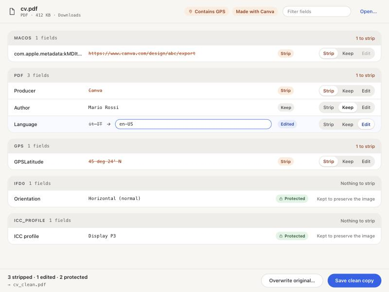

# MetaStrip

**A native macOS app that strips hidden metadata from your files — "Made with Canva", authors, dates, GPS, the website you downloaded it from.**
**Everything runs locally: your files never leave your Mac.**



## Why

Files carry more than you think:

- A CV exported from Canva says *Producer: Canva*, plus when it was created and edited.
- A photo can hold the camera, the date it was taken and the GPS position.
- A file you downloaded remembers **the exact URL it came from** (macOS stores it in `kMDItemWhereFroms`) and which browser saved it.

MetaStrip shows you all of it and lets you decide, field by field, what goes.

## Private by design

- **100% offline.** No server, no upload, no account, no analytics, no web fonts. The app makes no network requests at all.
- Everything is done on your Mac by two well-known open-source tools: [ExifTool](https://exiftool.org) and [qpdf](https://qpdf.sourceforge.io).
- **PDFs are fully rewritten**, not patched. A normal metadata edit leaves the old values recoverable inside the file; MetaStrip removes them for good.
- **The original is untouched by default**: you get a `_clean` copy. Overwriting asks first.

## What it does

- Drag a file onto the window (or Open…) and see every metadata field, grouped by source: EXIF, XMP, IPTC, PDF info, macOS attributes.
- For each field choose **Strip**, **Keep** or **Edit**. Editing is useful too: e.g. fix a PDF whose language says `it-IT` while the text is English.
- **Protected fields** (colour profile, orientation, resolution) are shown but locked, so your image never looks different after cleaning.
- Removes macOS "downloaded from" and quarantine attributes.
- Warns you at a glance: *Contains GPS*, *Made with Canva*.
- Interface in English, Italiano, Español, 中文, Deutsch, Français (⌘, to switch).

Works with images (JPEG, PNG, HEIC, TIFF…), PDFs, Office documents, video and anything else ExifTool understands.

## Install

Requirements: macOS, [Homebrew](https://brew.sh), Python 3.

```bash
brew install exiftool qpdf
git clone https://github.com/kernelpanikk/metastrip.git && cd metastrip
python3 -m venv .venv && .venv/bin/pip install pywebview pyinstaller
./build.sh
ditto dist/MetaStrip.app /Applications/MetaStrip.app
```

Or run it without building: `.venv/bin/python app.py`.

The app uses the Homebrew `exiftool` and `qpdf`, so keep them installed. It isn't signed with an Apple Developer ID: if you build it yourself it just opens; if someone sends you a built copy, macOS will ask you to confirm the first time.

## How it's made

This project is **vibecoded**: built in an afternoon by chatting with [Claude Code](https://claude.com/claude-code). It's small on purpose:

- `core.py`: reads and writes metadata (ExifTool, qpdf, `xattr`)
- `index.html`: the whole interface
- `app.py`: native window via [pywebview](https://pywebview.flowrl.com)
- `test_core.py`: self-check on real JPG, PNG and PDF files (`.venv/bin/python test_core.py`)

Issues and pull requests welcome.

## License

[MIT](LICENSE)
